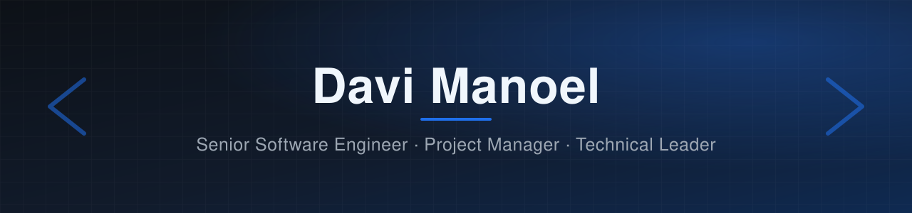

  

  # Davi Manoel

  ### Full-Stack Developer · Software Engineer

  **10+ years building and evolving web applications, from the interface to the database.**

  <a href="https://davimanoel.com.br">Website</a>&nbsp;&nbsp;·&nbsp;&nbsp;
  <a href="https://github.com/sondavi1991">GitHub</a>

    

  

## About Me

I am a Full-Stack Developer and Software Engineer with more than 10 years of experience designing, developing, evolving, and delivering software products.

My work spans the whole stack: user interfaces, back-end services, databases, and the integrations that connect them. I focus on turning business needs into pragmatic, maintainable, and sustainable technical solutions.

Much of my professional experience has been built through private projects, client work, and business-oriented digital products. While those projects cannot always be shared publicly, this profile is being expanded with selected work that reflects my approach to engineering and delivery.

<table>
  <tr>
    <td width="50%" valign="top">
      <h3>Engineering</h3>
      <ul>
        <li>Web applications and digital products</li>
        <li>Front-end and back-end integration</li>
        <li>Legacy-system modernization</li>
        <li>Maintenance and continuous improvement</li>
        <li>Pragmatic, maintainable architecture</li>
      </ul>
    </td>
    <td width="50%" valign="top">
      <h3>Full-Stack Development</h3>
      <ul>
        <li>Front-end interfaces with React and TypeScript</li>
        <li>Back-end development with Node.js and PHP, including WordPress</li>
        <li>Relational databases (PostgreSQL) and data modeling</li>
        <li>Integrations with services such as WhatsApp and e-mail (SMTP)</li>
        <li>Containerized deployment with Docker</li>
      </ul>
    </td>
  </tr>
</table>

## Core Technologies

  
  
  
  
   
  
  
  
  

## Professional Focus

- Building and evolving web platforms, applications, and custom digital products
- Developing both sides of the stack, from React interfaces to APIs and databases
- Integrating third-party services, such as WhatsApp and e-mail, into business workflows
- Maintaining and modernizing established systems without losing operational continuity
- Writing clear, maintainable code with attention to technical quality and continuous improvement

## Selected Public Work

<table>
  <tr>
    <td width="50%" valign="top">
      <h3>Simulador Guia</h3>
      
Full-stack web application for health-plan simulation and recommendation: a configurable multi-step form, an admin panel, and lead routing to sales consultants via WhatsApp. React, Express and PostgreSQL, all in TypeScript, shipped with Docker.

      <a href="https://github.com/sondavi1991/simuladorguia"><strong>Explore repository →</strong></a>
    </td>
    <td width="50%" valign="top">
      <h3>Matemago 1 (Unity WebGL)</h3>
      
Browser build of the game Matemago 1, exported from Unity to WebGL and WebAssembly and served as a static site. Part of the HTML5 game work for Clickideias.

      <a href="https://github.com/sondavi1991/jogosFlash"><strong>Explore repository →</strong></a>
    </td>
  </tr>
</table>

## Engineering Principles

> Good engineering is not just about writing code. It is about understanding the problem, making responsible trade-offs, and delivering software that can continue to evolve.

- **Clarity over unnecessary complexity**
- **Business context alongside technical quality**
- **Sustainable delivery over short-term shortcuts**
- **Collaboration, ownership, and transparent communication**
- **Incremental improvement in code, architecture, and processes**

## Building in Public

I am expanding this portfolio with carefully selected public projects and case studies that demonstrate my experience in software architecture, full-stack development, and legacy-system modernization.

## Connect

- **Website:** <a href="https://davimanoel.com.br">davimanoel.com.br</a>
- **GitHub:** <a href="https://github.com/sondavi1991">github.com/sondavi1991</a>
